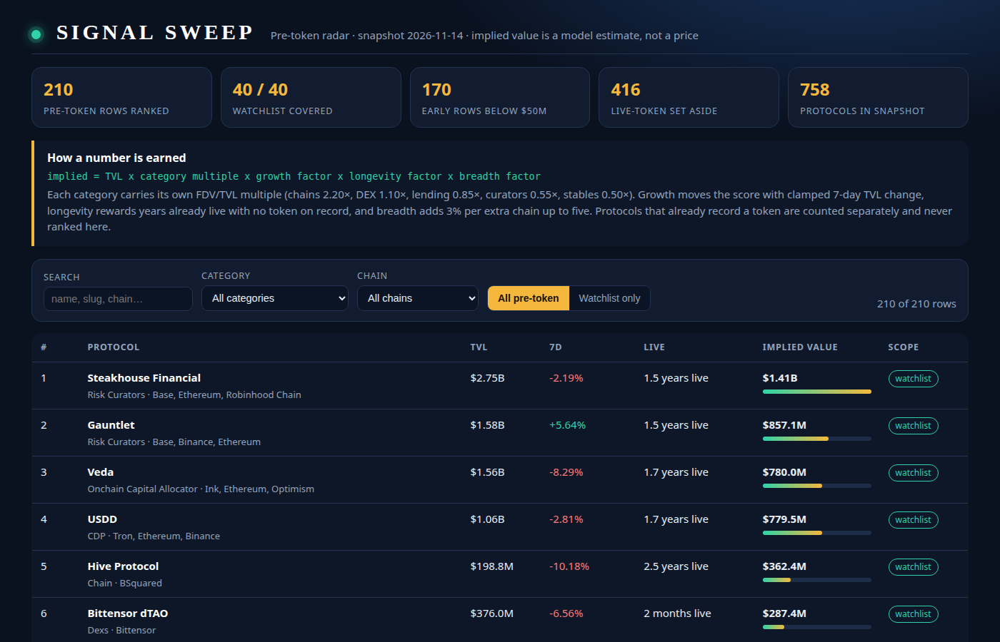
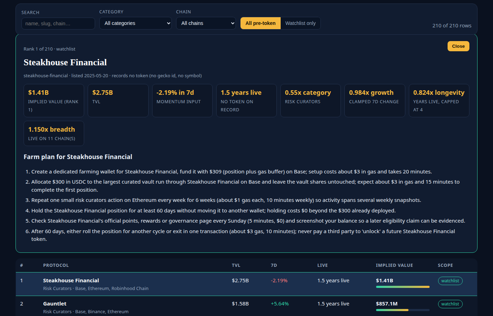
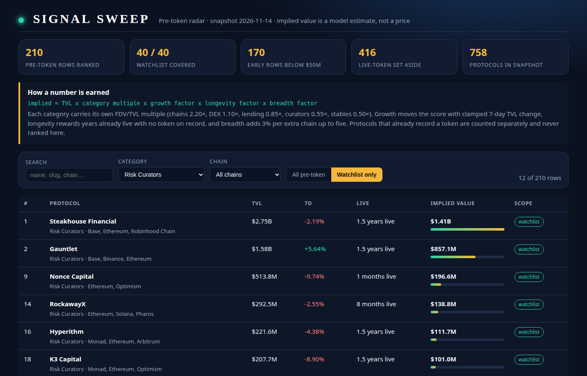

# Signal Sweep

A pre-token opportunity radar: a small dashboard that collects early token signals and ranks them with a transparent, published scoring model, so every score on the board can be traced back to the signals that produced it.

Signal Sweep was created as an entry to the make.fun **token-radar-01** bounty (November 2026) and passed the full submission kit check, 15 of 15.

## Run

Open `dashboard/index.html` in a browser, or serve the folder with any static file server. No build step.

## Screenshots

| Board | Detail |
| --- | --- |
|  |  |

Filtered view: 

## Structure

- `lib/model.ts` : the scoring model and its weights
- `lib/farm.ts` : signal collection
- `dashboard/` : the board UI (HTML, CSS, JavaScript)

## Author

0xTreasure · X: [@0xTreasureDev](https://x.com/0xTreasureDev)
